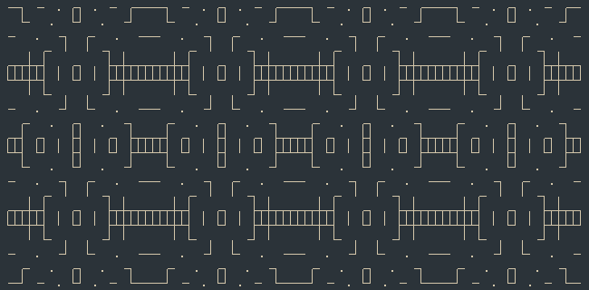

# forma

**2D grid shape generation in Lua**



**forma** is a utility library for the procedural generation and manipulation of
shapes on a two dimensional grid or lattice. It came about as part of
experiments in making roguelike games. **forma** is therefore particularly
suited (but not limited) to the generation of roguelike environments.

## Installation

```bash
luarocks install forma
```

Or for development:

```bash
git clone https://github.com/nhartland/forma
cd forma
luarocks make rockspec/forma-scm-1.rockspec
```

## Features

- **A spatial-hashing pattern** class with sparse set storage for fast lookup, insertion, and removal of active cells.
- **Pattern manipulators** such as union, subtraction, intersection, XOR, rotation, reflection, dilation, erosion, opening, closing and morphological gradient.
- **Rasterisation algorithms** for 2D primitives, e.g lines, circles, squares and Bezier curves.
- A **multipattern** class for handling collections of patterns with batch operations.
- A **raycasting** tool for computing visible areas from a source cell.
- A very flexible **cellular automata** implementation with synchronous and asynchronous updates, and combination of multiple rule sets.
- **Pattern sampling** algorithms including random, Perlin noise, Poisson-disc, and Mitchell's best-candidate sampling.
- **Algorithms for subpattern finding** including flood-fill, convex hull, thinning/skeletonisation, binary space partitioning, and Voronoi tessellation.

## Quick Example

```lua
local primitives    = require('forma.primitives')
local automata      = require('forma.automata')
local neighbourhood = require('forma.neighbourhood')

-- Generate a square box to run the CA inside
local domain = primitives.square(80, 20)

-- CA initial condition: 800-point random sample of the domain
local ca = domain:sample(800)

-- Moore (8-cell) neighbourhood 4-5 rule
local moore = automata.rule(neighbourhood.moore(), "B5678/S45678")

-- Run the CA until converged or 1000 iterations
local ite, converged = 0, false
while converged == false and ite < 1000 do
    ca, converged = automata.iterate(ca, domain, {moore})
    ite = ite + 1
end

-- Find all 4-contiguous connected components
local segments = ca:connected_components(neighbourhood.von_neumann())
```

## Compatibility

forma supports Lua 5.1, 5.2, 5.3, 5.4, and LuaJIT.
